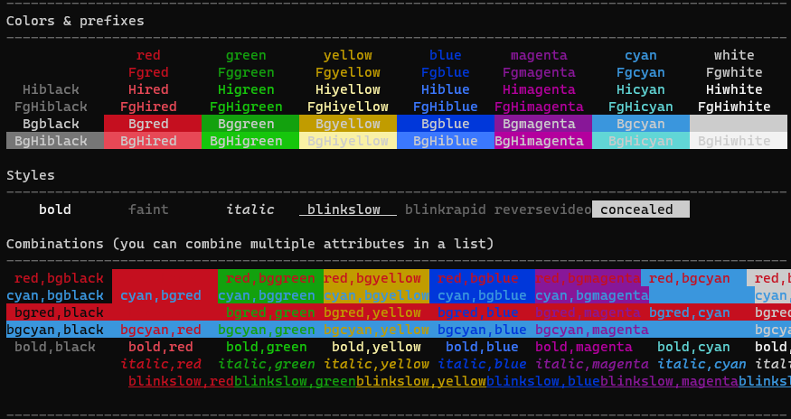

# Labctl color reference

## CLI command

The `labctl color` command allows you to run any normal shell command and add some color.
Labctl will use regular expressions to search for text of interest in the output and can then highlight these using defined colors.


::: details `labctl color --help`
```
Usage: labctl color <cmd> ...

Add some color to any Linux command (i.e. ssh).

Arguments:
  <cmd> ...

Flags:
  -h, --help    Show context-sensitive help.

Global Flags
  -d, --debug=INT          Enable debug mode.
      --settings=STRING    Settings yaml file.

labctl: error: expected "<cmd> ..."
```
:::

### Example

```
labctl color ssh 10.0.0.1
```


::: tip
When you use `labctl color` any flags should be before the **color** command!

Correct: <code>labctl -d color ssh 10.0.0.1</code>

Wrong: <code>labctl color <span style="color:red">-d</span> ssh 10.0.0.1</code> (-d will be interpreted as part of the ssh command)

:::


## Colors

Valid colors include: `black`, `red`, `green`, `yellow`, `blue`, `magenta`, `cyan`, `white`.
You can add the following prefixes to colors: `hi` - Highlight, `fg` - Foreground, `bg` - Background

Valid styles include: `bold`, `faint`, `italic`, `blinkslow`, `blinkrapid`, `reversevideo`, `concealed`, `crossedout`

You can see a list of colors on how they are displayed on your terminal by using the --test flag

```bash
labctl color --test
```




::: tip
The screenshot was made on Microsoft's Windows Terminal. It supports all the colors and a blinking `blinkrapid`
:::

## Labctl settings

See [settings](./settings.md)
